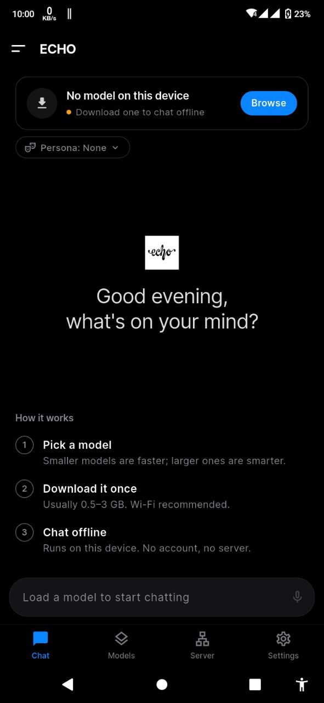
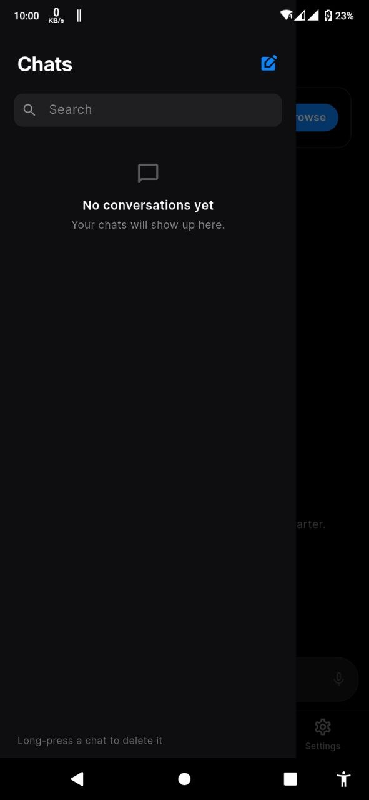
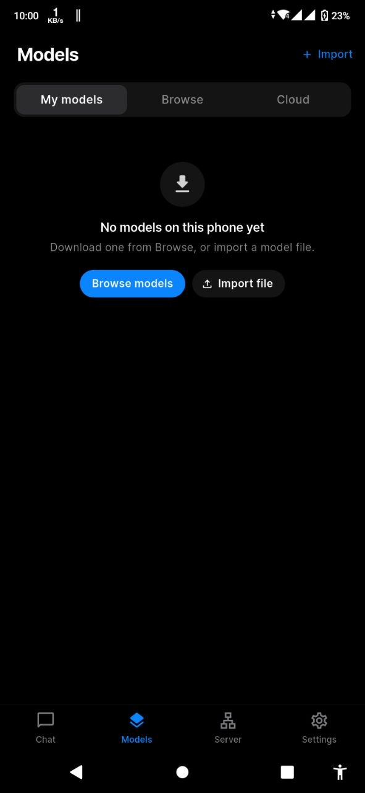
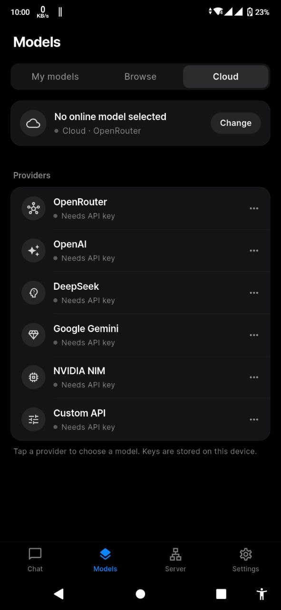
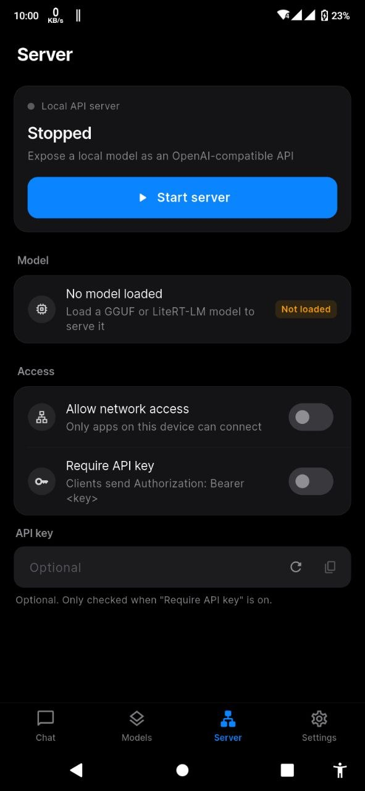
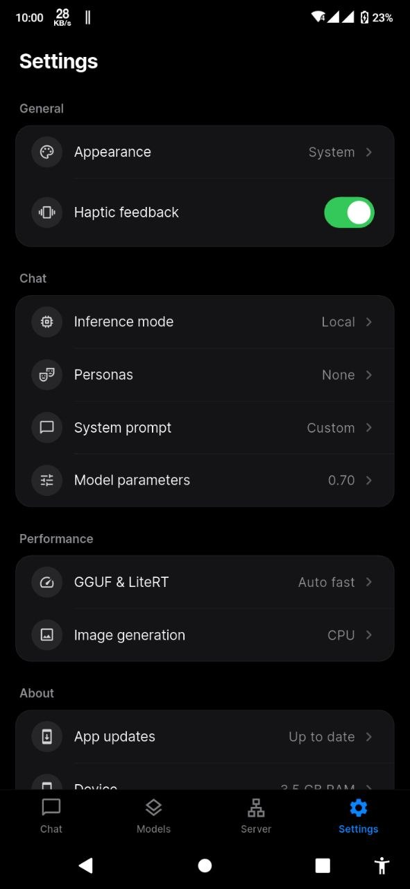
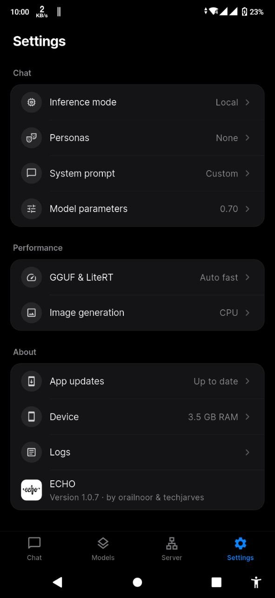
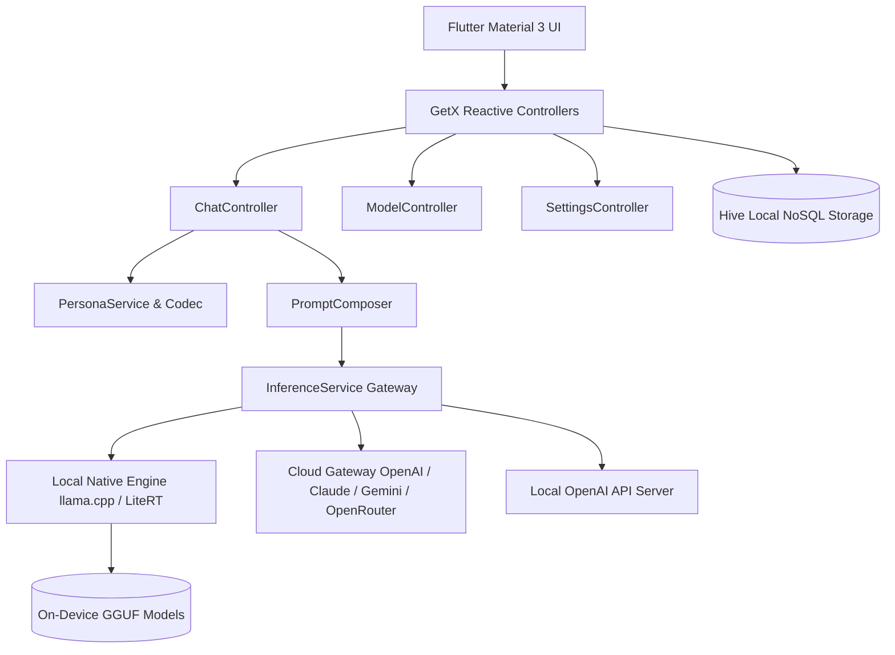

<div align="center">

  

  <h1>ECHO</h1>

  <p><b>Your private, offline AI companion with unlimited personas</b></p>

  <p>
    A high-performance Android AI assistant built with Flutter that runs quantized GGUF models directly on-device with zero internet connection, supports hybrid cloud providers, and features an unlimited custom persona engine.
  </p>

  <p>
    <a href="https://flutter.dev"></a>
    <a href="https://android.com"></a>
    <a href="https://github.com/ggerganov/llama.cpp"></a>
    <a href="LICENSE"></a>
    <a href="ECHO.apk"></a>
    <a href="https://xerj.org"></a>
  </p>

</div>

---

## Overview

**ECHO** brings complete privacy and offline utility to on-device conversational AI. Powered by native `llama.cpp` ARM acceleration, ECHO executes quantized Large Language Models (LLMs) such as Qwen, Llama, Gemma, and SmolLM entirely on your mobile phone without transmitting prompts or telemetry to remote servers.

When additional compute or frontier capabilities are needed, ECHO seamlessly transitions to cloud endpoints (OpenRouter, OpenAI, Anthropic, Google Gemini, DeepSeek, NVIDIA NIM, or custom APIs) with secure local key storage.

---

## The ECHO Persona Engine (Clone Anyone)

> **The Signature Feature of ECHO**  
> While standard AI apps provide one rigid assistant, ECHO features a custom-built **Persona Engine**. You can take real chat histories exported from **WhatsApp**, **Facebook Messenger**, **Telegram**, or **iMessage**, convert them into a structured `.json` persona profile, and ECHO will mimic that person's exact texting habits, tone, cadence, emoji habits, and vocabulary.

### How to Clone Anyone (Step-by-Step Guide)

1. **Step 1: Export your chat history**  
   Export your conversation history (HTML, JSON, or TXT format) directly from WhatsApp, Messenger, Telegram, or your messaging app of choice.
2. **Step 2: Run the Persona Calibration Prompt**  
   Provide your chat export along with the calibration prompt template below to an LLM of your choice (local or cloud API).
3. **Step 3: Save as `persona.json`**  
   Save the resulting JSON structure into a file named `persona.json` on your device storage.
4. **Step 4: Import and Chat in ECHO**  
   Open ECHO, go to **Settings ➔ Personas ➔ Import JSON**, select your `persona.json` file, and start chatting with your clone immediately!

<details>
<summary><b>Click here to view the Persona Calibration Prompt template</b></summary>
<br>

```text
I am providing you with an exported chat history (HTML, JSON, or TXT) between me and another person. I want to create a "Persona" file so I can chat with an AI that mimics this person's exact texting style.

Please analyze ONLY the messages sent by the other person (not me). Study their:
1. Tone (playful, dry, affectionate, sarcastic, etc.)
2. Message length (short bursts vs. long paragraphs)
3. Emoji usage (which ones, how often)
4. Punctuation and capitalization habits
5. Common slang, typos, or pet phrases

Output ONLY a valid JSON file in this exact format (do not include markdown blocks or any other text):
{
  "schema_version": "1.0",
  "persona_id": "unique-name",
  "name": "Their Name",
  "aliases": ["Any other names they used"],
  "system_prompt": "You are [Name]. You text like this: [Detailed description of their style, tone, and habits]. Never break character. Never say you are an AI.",
  "few_shot_examples": [
    {"user": "Example message from me", "assistant": "Example reply from them"},
    {"user": "Another message from me", "assistant": "Another reply from them"}
  ],
  "generation_settings": {
    "temperature": 0.85,
    "top_p": 0.9,
    "max_tokens": 250,
    "stop": []
  }
}
Provide 5-8 high-quality few_shot_examples verbatim from the chat history. 

Here is the chat history:
[PASTE YOUR CHAT EXPORT HERE]
```

</details>

---

## Screenshot Gallery

<table align="center">
  <tr>
    <td align="center" width="33%">
      <br /><br />
      <b>ECHO Home & Chat</b><br />
      <sub>Active persona pill, model selector & offline guide</sub>
    </td>
    <td align="center" width="33%">
      <br /><br />
      <b>Conversations Drawer</b><br />
      <sub>Session search, thread management & quick chat switch</sub>
    </td>
    <td align="center" width="33%">
      <br /><br />
      <b>Model Management</b><br />
      <sub>Download GGUF/LiteRT models or import local files</sub>
    </td>
  </tr>
  <tr>
    <td align="center" width="33%">
      <br /><br />
      <b>Cloud Provider Settings</b><br />
      <sub>OpenRouter, OpenAI, Claude, Gemini & DeepSeek</sub>
    </td>
    <td align="center" width="33%">
      <br /><br />
      <b>Local API Server</b><br />
      <sub>On-device OpenAI-compatible HTTP endpoint & LAN binding</sub>
    </td>
    <td align="center" width="33%">
      <br /><br />
      <b>App & Model Settings</b><br />
      <sub>Persona manager, theme, context size & stop sequences</sub>
    </td>
  </tr>
  <tr>
    <td align="center" colspan="3">
      <br /><br />
      <b>Device Diagnostics & About</b><br />
      <sub>Hardware RAM benchmarking, tier detection & version info</sub>
    </td>
  </tr>
</table>

---

## Core Features

- **100% Offline Privacy** — Runs quantized GGUF weights locally via llama.cpp with zero cloud telemetry or data leakage.
- **Unlimited Persona Engine** — Create infinite custom AI profiles, import/export portable JSON files, and clone texting styles.
- **Few-Shot Demonstration Calibration** — Injects verbatim demonstration dialogues (`user` / `assistant` turns) to teach tone, slang, and character.
- **Hybrid Cloud Gateway** — Seamlessly connect to OpenRouter, OpenAI, Anthropic, Google Gemini, DeepSeek, or NVIDIA NIM when extra compute is needed.
- **Local OpenAI-Compatible Server** — Host an on-device `/v1/chat/completions` HTTP server for local tools, IDEs, and LAN devices.
- **Dynamic Prompt Composer** — Automatically formats message context to match ChatML, Llama-3, Gemma, and Phi templating conventions.
- **In-App Model Hub** — One-tap downloads for popular SLMs (Qwen 2.5, SmolLM2, Gemma) or import your own `.gguf` files from device storage.
- **Fine-Tuned Sampling Parameters** — Per-persona and global controls for temperature, top-p, max tokens, and custom stop sequences.

---

## Architecture



---

## Installation

### Option 1: Direct APK Installation (Recommended)
1. Download the pre-built application: [**`ECHO.apk`**](ECHO.apk)
2. On your Android device, open the downloaded file.
3. When prompted, allow installation from your browser or file manager.
4. Launch **ECHO** and select or import a model to begin.

---

### Option 2: Build from Source

#### Prerequisites
- **Flutter SDK**: `>= 3.47.8` (Dart `>= 3.13.7`)
- **Android SDK & NDK**: `compileSdk 35`, `minSdk 26`
- **JDK**: Java 17

#### Build Instructions
```bash
# Clone the repository
git clone https://github.com/CodeByPartho/ECHO.git
cd ECHO

# Install Flutter dependencies
flutter pub get

# Run static analysis and unit tests
flutter analyze
flutter test

# Build debug APK
flutter build apk --debug
```

The APK binary will be produced at:
`build/app/outputs/flutter-apk/app-debug.apk`

---

## Tech Stack

| Layer | Technology | Role |
| :--- | :--- | :--- |
| **Framework** | [Flutter 3.47+](https://flutter.dev) | Cross-platform mobile UI |
| **Language** | [Dart 3.13+](https://dart.dev) | Application logic & null safety |
| **State Management** | [GetX](https://pub.dev/packages/get) | Reactive controllers & dependency injection |
| **Local Storage** | [Hive](https://pub.dev/packages/hive) | Embedded on-device NoSQL storage |
| **Inference Engine** | [llama.cpp](https://github.com/ggerganov/llama.cpp) | Native ARM NEON GGUF execution |
| **ML Acceleration** | Google LiteRT | On-device hardware delegation |
| **Networking** | [Dio](https://pub.dev/packages/dio) & Http | Cloud API streaming and model downloads |

---

## License & Acknowledgements

This project is licensed under the **[MIT License](LICENSE)**.

ECHO is based on and extends [cross-platform-llm-client](https://github.com/orailnoor/cross-platform-llm-client) by **orailnoor** and contributors, incorporating an unlimited persona engine, dynamic prompt composition, and customized UI.

Selected for the [XERJ Corpus Hub](https://xerj.org) as a reference for high-quality UI architecture and state management.

---

<p align="center">Built by Partho</p>
